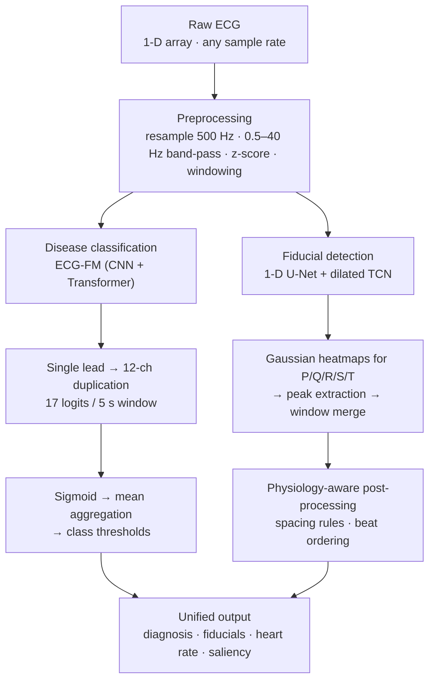

# BeatNet — Explainable Single-Lead ECG Analysis

> An end-to-end ECG analysis platform that turns a raw single-lead, 30-second wearable recording into **17-class cardiac condition predictions**, **millisecond-level P/Q/R/S/T fiducial delineation**, **heart rate**, and **saliency-based explanations** — in one pipeline.

**Sponsor:** Aventusoft, Inc. · **Program:** Integrated Product & Process Design (IPPD), University of Florida · **Team project (6 members)** · **Delivered:** Spring 2026

🔗 **Live demo:** <https://ippd-ca.politeforest-729c8e80.eastus.azurecontainerapps.io>

---

## Why this project

Aventusoft builds portable, cloud-connected cardiac monitors that record single-lead, 30-second ECGs at 500 Hz. Their existing tooling finds Q and R points but does not delineate every waveform landmark or provide end-to-end rhythm analysis, and most of their data is unlabeled.

BeatNet closes that gap: a modular, deployable software stack that is accurate enough to be useful, **explainable** enough to be trusted, and light enough to run on cloud and (eventually) mobile.

## What it does

| Output | Description |
|---|---|
| **17-class multi-label diagnosis** | Sinus rhythm, PVC, AFib, atrial flutter, tachycardia, bradycardia, RBBB, LBBB, bifascicular block, AV blocks, SVT, ventricular tachycardia, infarction, pacemaker, accessory pathway, poor data quality |
| **PQRST delineation** | P, Q, R, S, T landmark locations with confidence |
| **Heart rate** | Derived from detected R–R intervals |
| **Saliency / interpretability** | Highlights the beats and waveform regions that drove each prediction |
| **Unified output** | Labels, confidence scores, fiducial indices, heart rate, sample rate and duration in one structured response |

An interactive dashboard lets you pick a patient, adjust the decision threshold, and view the full 30 s waveform, PQRST overlay, ground truth, heart rate and per-class probabilities side by side.

## Architecture



Five coordinated subsystems with standardized interfaces, so any one can be retrained or swapped without touching the rest:

1. **Preprocessing** – validation, resampling, filtering, normalization, 5 s / 30 s windowing, patient-level splits
2. **ECG-FM classification** – a pretrained transformer ECG foundation model, fine-tuned for single-lead wearable input
3. **1-D U-Net delineation** – residual U-Net encoder/decoder with a dilated Temporal Conv. Network bottleneck
4. **Saliency module** – attention and gradient-based explanations projected back onto the waveform
5. **Unified integration layer** – single callable inference API, Docker-packaged

## Key technical ideas

- **Foundation-model transfer to a harder input.** ECG-FM is pretrained on 12-lead data; the wearable gives one lead. A compatibility wrapper duplicates the lead into a `12 × 5000` tensor while preserving timing, so the pretrained weights are reused instead of redesigning the model.
- **Heatmap-based delineation.** Peaks are supervised as Gaussian bumps rather than binary labels, giving smoother training signal and sub-sample localization.
- **Morphology-aware post-processing.** Enforces physiologic spacing, removes duplicate/clustered detections, corrects beat ordering and refines T-wave boundaries — a large real-world robustness gain over raw model output.
- **Robust aggregation.** Each 30 s recording is split into six 5 s windows; probabilities are mean-aggregated (max-aggregation was evaluated but is more false-positive prone) then thresholded per class.
- **Clinical plausibility checks.** A rule-based layer verifies multi-label output (e.g. LBBB + RBBB, or AFib + sinus rhythm, are flagged as invalid combinations).
- **Explainability by design.** Predictions come with PQRST overlays and saliency maps so outputs can be sanity-checked against recognizable ECG morphology.

## Results

Measured in acceptance testing against sponsor-defined criteria (10 tests, T-01 … T-10).

### Classification (17 labels, MIMIC-IV-ECG, held-out test set)

| Metric | Result | Target |
|---|---|---|
| **Overall AUROC (17-class)** | **0.976** | ≥ 0.95 |
| Tachycardia AUROC | 0.994 | ≥ 0.95 |
| Atrial fibrillation AUROC | 0.992 | ≥ 0.95 |
| PVC AUROC | 0.983 | ≥ 0.95 |
| Sinus rhythm AUROC | 0.985 | — |
| Infarction AUROC | 0.832 (Lead II) / 0.730 (Lead I) | ≥ 0.90 ❌ |

Per-class numbers (AUROC, AUPRC, accuracy, recall, precision, F1, specificity, NPV) for Lead I and Lead II are in the full report.

### Fiducial delineation (LUDB / QTDB)

| Peak | Precision | Recall | F1 | MAE (ms) |
|---|---|---|---|---|
| P | 0.798 | 0.812 | 0.805 | 18.3 |
| Q | 0.887 | 0.903 | 0.895 | 9.1 |
| **R** | **0.964** | **0.971** | **0.967** | **4.2** |
| S | 0.921 | 0.933 | 0.927 | 6.8 |
| T | 0.834 | 0.819 | 0.826 | 14.7 |
| **Macro avg** | 0.881 | 0.888 | 0.884 | 10.6 |

### System-level

| Test | Outcome |
|---|---|
| End-to-end pipeline I/O (T-07) | Pass — valid schema at every stage |
| Multi-label plausibility (T-08) | Pass — no physiologically impossible combinations observed |
| Reproducibility (T-09) | Pass — 98–99 % identical predictions across runs (fixed seeds) |
| Real-world wearable data (T-10) | In progress — 6 patients; R-peaks stable, P/T marginal, labels pending clinical confirmation |

### Honest limitations

- **Infarction** detection from a single lead falls below target — it depends on spatial information across leads that a single lead cannot provide. Lead II is noticeably better than Lead I.
- **P and T waves** are harder to localize (low amplitude, noise- and baseline-sensitive) and miss the ≤ 10 ms goal.
- **Rare classes** (e.g. ventricular tachycardia, atrial flutter) have low precision because of class imbalance.
- Real-world wearable validation used a small cohort (6 patients) with partially unavailable ground truth.
- Outputs are AI-assisted screening, **not a clinical diagnosis**.

## Case studies

| Case | Top predictions |
|---|---|
| **PVC** | PVC 0.998 |
| **Right bundle branch block** | RBBB 0.993, bifascicular block 0.957 |
| **LBBB + ventricular tachycardia** | LBBB 0.957, ventricular tachycardia 0.926 |

## Tech stack

**Modeling:** PyTorch · ECG-FM · fairseq-signals · 1-D U-Net + dilated TCN
**Signal processing:** NumPy · SciPy · WFDB · Pandas · Matplotlib
**Data:** MIMIC-IV-ECG (classification), LUDB & QTDB (delineation), PTB-XL, MIT-BIH, Chapman–Shaoxing (benchmarking), Aventusoft wearable recordings (real-world validation)
**Compute & deployment:** UF HiPerGator (SLURM, A100/H100) · Docker · Azure Container Apps · ONNX Runtime / CoreML explored for edge
**Cost:** built on open-source tooling and academic compute for under US$200 in direct costs

## Quick start

```bash
# environment
conda create -n beatnet python=3.10 && conda activate beatnet
pip install numpy scipy pandas matplotlib scikit-learn tqdm wfdb pyyaml onnxruntime

# ECG-FM tooling
git clone https://github.com/Jwoo5/fairseq-signals.git
cd fairseq-signals && pip install -e . && cd ..

# place checkpoints
#   models/ecgfm/        – fine-tuned ECG-FM weights
#   models/delineation/  – U-Net fiducial weights

# run inference on a single recording
python run_beatnet.py --input ecg.dat --lead II
```

Configuration (lead selection, window/stride, per-class thresholds) is documented in the project manuals. Example:

```yaml
lead_selection: II
window_seconds: 30
stride_seconds: 5
thresholds: { PVC: 0.45, LBBB: 0.55, AFib: 0.50, Normal: 0.60 }
```

> Model checkpoints and the MIMIC-IV-ECG dataset are not included in this repository (PhysioNet credentialed access / data-use agreement required).

## Planned repository layout

```
preprocessing/    signal cleanup & tensor preparation
classification/   ECG-FM model logic
delineation/      PQRST U-Net + post-processing
interpretability/ saliency generation
inference/        unified runtime pipeline
tests/            validation scripts
scripts/          SLURM / Docker / evaluation helpers
docs/             manuals
```

This repository currently holds the project's supporting web pages (`index.html`, `model_operations.html`, `references.html`).

## Future work

- Real-time streaming from Aventusoft devices to an Azure-hosted pipeline
- Quantization and lightweight inference for edge / mobile
- More diverse data for under-represented conditions (infarction, flutter, VT)
- Better P- and T-wave localization
- Longitudinal patient dashboard

## Regulatory note

If commercialized as a clinical decision-support product, BeatNet would likely fall under Software as a Medical Device (FDA Class II via 510(k) or De Novo) and would need alignment with IEC 62304, ISO 14971, HIPAA and cybersecurity expectations. This prototype makes no clinical claims.

## Team

| Name | Program |
|---|---|
| Varun Sai Vemuri | M.S. Artificial Intelligence Systems, UF |
| Arul Sathya Rajasrinivasan | M.S. Artificial Intelligence Systems, UF |
| **Mohammed Abraar Khan** | M.S. Artificial Intelligence Systems, UF |
| Prithvi Halagere Lokesha | M.S. Artificial Intelligence Systems, UF |
| Tzuchieh (Jeremy) Chao | M.S. Applied Data Science, UF |
| Divyansh Agarwal | M.S. Applied Data Science, UF |

**Faculty coach:** Dr. Kejun Huang, Dept. of Electrical & Computer Engineering, UF
**Sponsor liaisons:** Dr. Keider Hoyos and Dr. Diego Pava, Aventusoft, Inc.

## References

1. F. Liu, S. Zhou, Q. Xie — *An open electrocardiogram foundation model for universal representation learning* (ECG-FM), arXiv, 2024.
2. O. Ronneberger, P. Fischer, T. Brox — *U-Net: Convolutional networks for biomedical image segmentation*, MICCAI, 2015.
3. P. Wagner et al. — *PTB-XL, a large publicly available electrocardiography dataset*, Scientific Data, 2020.
4. A. Hannun et al. — *Cardiologist-level arrhythmia detection … using a deep neural network*, Nature Medicine, 2019.
5. G. Clifford et al. — *AF classification from a short single-lead ECG recording*, PhysioNet/CinC Challenge 2017.
6. Y. Ansari et al. — *Deep learning for ECG arrhythmia detection and classification: an overview of progress from 2017–2023*, Frontiers in Physiology, 2023.

---

*Built as part of UF's IPPD program for Aventusoft, Inc. Reports referenced here are the project's Final Design Review volumes (product & process documentation, acceptance test results, product manuals).*
