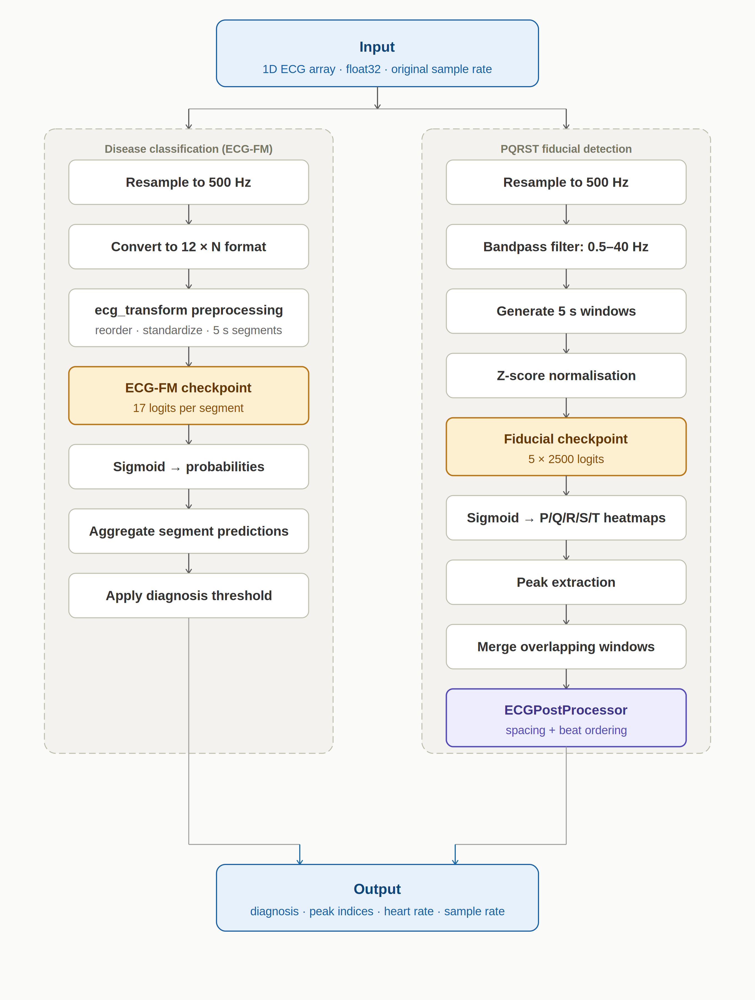
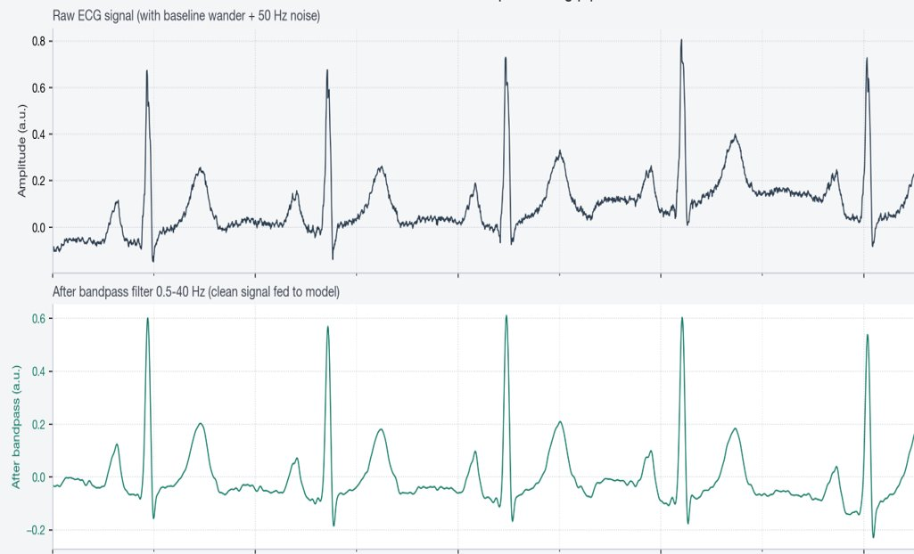
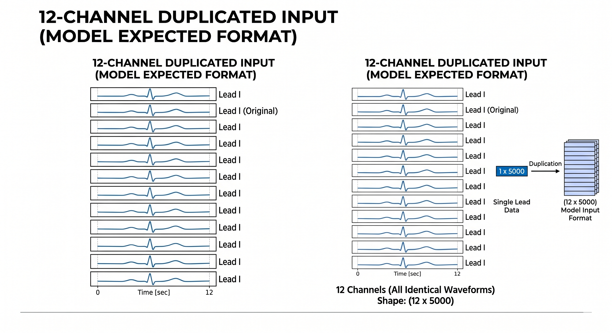
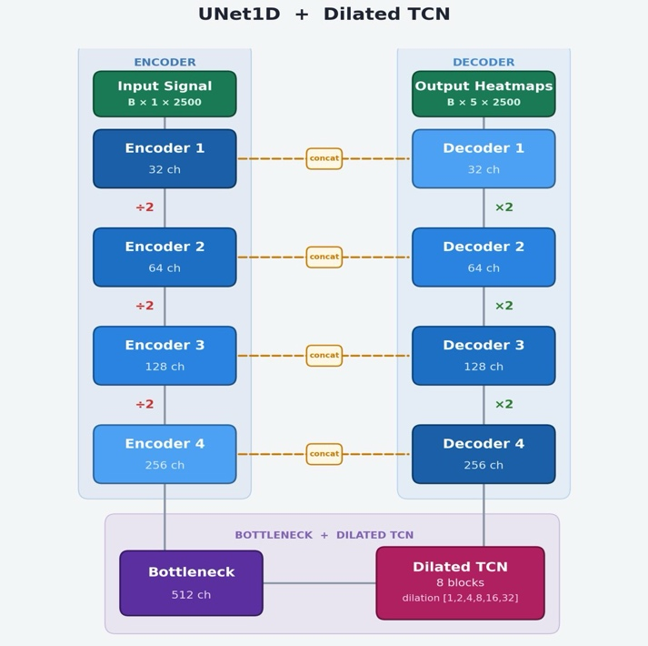
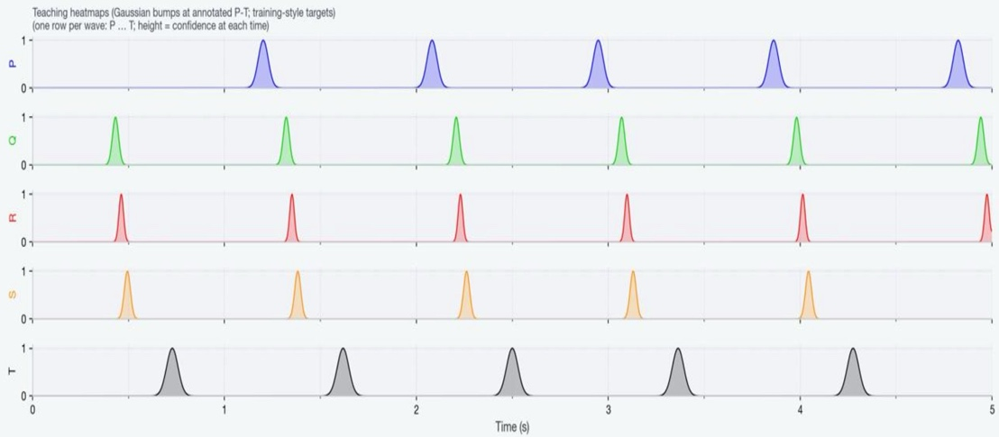
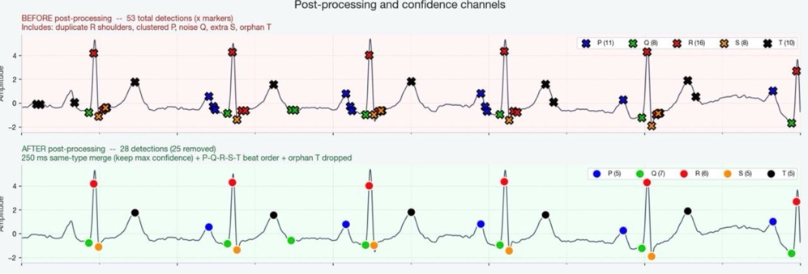

# Architecture

BeatNet is a modular pipeline: each subsystem has one job and a standardized interface, so it can be retrained or replaced without affecting the others.

## Subsystems

| # | Subsystem | Role |
|---|---|---|
| 1 | Preprocessing | Validates input (dimensions, sample rate, duration, numeric integrity); resamples to 500 Hz; 0.5–40 Hz 5th-order Butterworth band-pass; z-score normalization; 5 s / 30 s windowing; patient-level train/val/test splits |
| 2 | ECG-FM classification | Pretrained transformer ECG foundation model fine-tuned to 17 labels; single lead duplicated to 12 channels; sigmoid outputs; mean aggregation across windows; per-class thresholds |
| 3 | 1-D U-Net delineation | Residual U-Net encoder/decoder with dilated TCN bottleneck; outputs P/Q/R/S/T heatmaps; peak extraction and window merging; physiology-aware post-processing |
| 4 | Saliency / interpretability | Attention and gradient-based saliency projected onto the waveform |
| 5 | Unified integration layer | One callable inference API returning diagnosis, confidences, fiducial indices, heart rate, sample rate and duration; Docker-packaged |

## Preprocessing

## Classification branch

The pretrained model expects 12 leads, so the wearable's single lead is duplicated into a `12 × 5000` tensor (5000 samples = 10 s at 500 Hz) with timing preserved.

A 30 s recording is split into six non-overlapping 5 s windows (2500 samples each). Each window yields 17 logits → sigmoid → probabilities. Probabilities are mean-aggregated across windows (max aggregation was evaluated but is more sensitive to noisy segments), then thresholded (default ≥ 0.5, tunable per class).

## Delineation branch

- Encoder channels 32 → 64 → 128 → 256, bottleneck 512, with skip connections
- Dilated TCN: 8 blocks, dilations {1, 2, 4, 8, 16, 32}
- Input `B × 1 × 2500`, output `B × 5 × 2500` heatmaps
- Trained on LUDB and QTDB with Gaussian-bump targets

Post-processing enforces physiologic spacing, removes duplicate and clustered peaks, corrects P-Q-R-S-T ordering and refines T-wave boundaries.

## Interfaces

- **Input:** 1-D ECG array (NumPy, CSV, or serialized waveform object) + metadata (sampling rate, duration, optional source id)
- **Classification interface:** standardized waveform tensor, window indices, channel-formatted model input
- **Delineation interface:** filtered windows, normalized tensors, temporal offsets
- **Output:** diagnosis labels + probabilities, peak indices, heart rate, sample rate

## Planned deployment architecture

