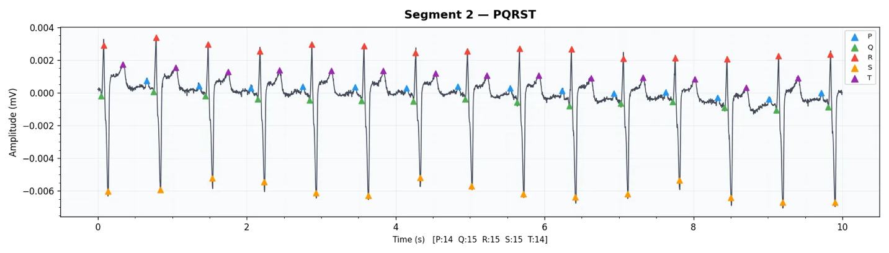
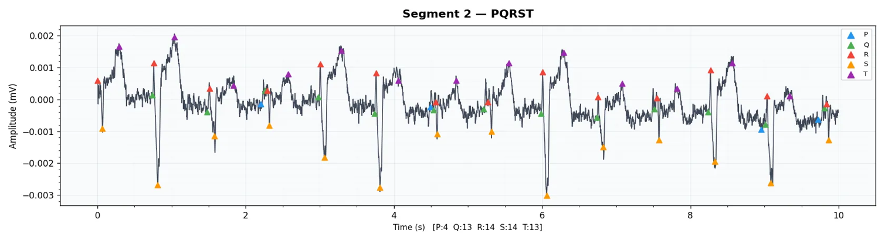
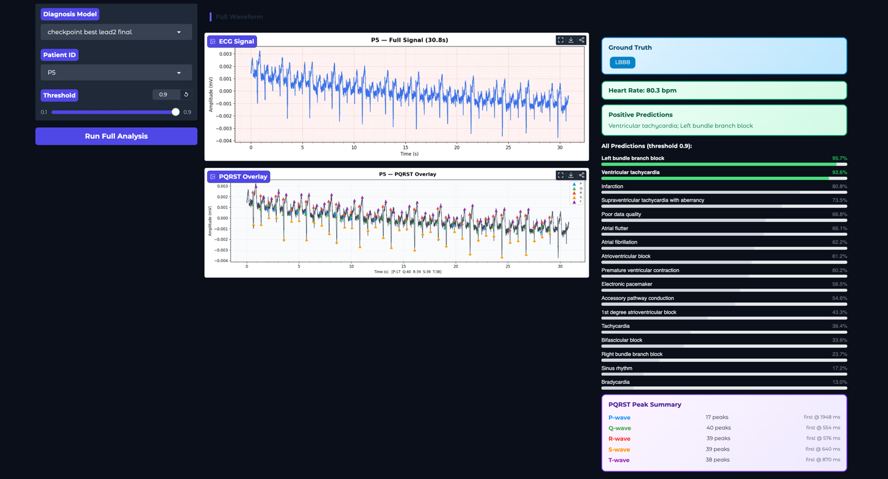

# Evaluation & Acceptance Results

Ten acceptance tests were run against sponsor-defined criteria. Classification used MIMIC-IV-ECG (held-out test split); delineation used LUDB and QTDB; real-world validation used Aventusoft wearable recordings.

## Acceptance summary

| Test | Feature | Metric | Target | Result | Status |
|---|---|---|---|---|---|
| T-01 | Overall classification (17 labels) | AUROC | ≥ 0.95 | 0.976 | PASS |
| T-02 | PVC detection | AUROC | ≥ 0.95 | ~0.98 | PASS |
| T-03 | Tachycardia detection | AUROC | ≥ 0.95 | ~0.98 | PASS |
| T-04 | Infarction detection | AUROC | ≥ 0.90 | 0.73 | FAIL |
| T-05 | P/Q/R/S detection | MAE | ≤ 10 ms | ~1.5–5 ms (as reported) | PASS |
| T-06 | T-wave detection | MAE | ≤ 10 ms | ~8–12 ms | MARGINAL |
| T-07 | Pipeline I/O | Format correctness | Valid schema | Correct | PASS |
| T-08 | Multi-label consistency | Logical validity | No conflicts | Valid | PASS |
| T-09 | Reproducibility | Run consistency | ≥ 98 % | 98–99 % | PASS |
| T-10 | Real-world wearable data | Clinical validation | Required | — | IN PROGRESS |

> Note: the source report is not fully self-consistent. The per-peak table below shows P and Q MAE above 10 ms, which differs from the summary line for T-05; and infarction AUROC appears as 0.73, 0.88 and 0.73/0.832 in different tables. Per-class appendix values are used here.

## Fiducial detection (per peak)

| Peak | Precision | Recall | F1 | MAE (ms) |
|---|---|---|---|---|
| P | 0.798 | 0.812 | 0.805 | 18.3 |
| Q | 0.887 | 0.903 | 0.895 | 9.1 |
| R | 0.964 | 0.971 | 0.967 | 4.2 |
| S | 0.921 | 0.933 | 0.927 | 6.8 |
| T | 0.834 | 0.819 | 0.826 | 14.7 |
| Macro avg | 0.881 | 0.888 | 0.884 | 10.6 |

## Per-class classification — Lead II

| Label | AUROC | AUPRC | Recall | Precision | F1 |
|---|---|---|---|---|---|
| Sinus rhythm | 0.985 | 0.996 | 0.943 | 0.984 | 0.963 |
| PVC | 0.983 | 0.852 | 0.978 | 0.326 | 0.489 |
| Tachycardia | 0.994 | 0.977 | 0.970 | 0.877 | 0.921 |
| Atrial fibrillation | 0.992 | 0.939 | 0.963 | 0.715 | 0.821 |
| Bradycardia | 0.994 | 0.970 | 0.978 | 0.809 | 0.885 |
| Accessory pathway | 0.990 | 0.952 | 0.947 | 0.759 | 0.843 |
| AV block | 0.986 | 0.915 | 0.938 | 0.640 | 0.761 |
| 1st-degree AV block | 0.992 | 0.933 | 0.957 | 0.679 | 0.794 |
| RBBB | 0.962 | 0.798 | 0.886 | 0.417 | 0.567 |
| LBBB | 0.978 | 0.730 | 0.941 | 0.294 | 0.448 |
| Bifascicular block | 0.985 | 0.730 | 0.945 | 0.281 | 0.433 |
| SVT w/ aberrancy | 0.977 | 0.671 | 0.974 | 0.230 | 0.372 |
| Atrial flutter | 0.967 | 0.568 | 0.900 | 0.144 | 0.249 |
| Ventricular tachycardia | 0.992 | 0.193 | 0.957 | 0.021 | 0.042 |
| Infarction | 0.832 | 0.658 | 0.748 | 0.463 | 0.572 |
| Pacemaker | 0.990 | 0.918 | 0.962 | 0.599 | 0.738 |
| Poor data quality | 0.710 | 0.085 | 0.481 | 0.055 | 0.099 |

Lead I results are similar but generally slightly lower (e.g. infarction AUROC 0.730).

## Multi-label plausibility

| Combination | Expected | Observed |
|---|---|---|
| LBBB + RBBB | Invalid | Not observed ✔ |
| AFib + sinus rhythm | Invalid | Not observed ✔ |
| Sinus rhythm + bradycardia / tachycardia | Valid | Observed ✔ |
| PVC + tachycardia | Valid | Observed ✔ |

## Reproducibility

Repeated runs with fixed seeds: average probability difference ≈ 0.015, 98–99 % identical final predictions.

## Case studies

| Case | Top predictions |
|---|---|
| PVC | PVC 0.998 |
| RBBB | RBBB 0.993, bifascicular block 0.957 |
| LBBB + VT | LBBB 0.957, ventricular tachycardia 0.926 |

## Dashboard

## Limitations

- Infarction from a single lead is below target (needs spatial information across leads); Lead II helps.
- P/T waves are harder to localize (low amplitude, noise).
- Rare classes have low precision due to class imbalance.
- Real-world validation: small cohort (6 patients), ground truth partly unavailable.
- AI-assisted screening only; not a clinical diagnosis.
